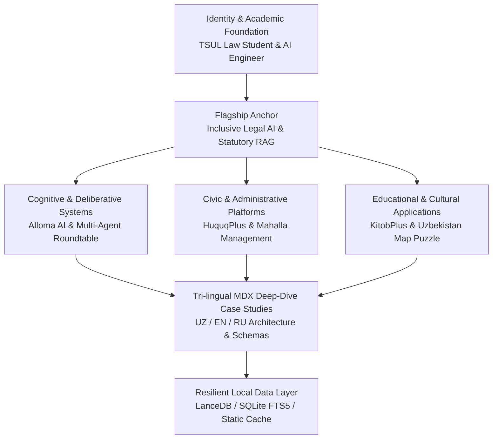

# 🏛️ Mansur Rustamov — Developer Portfolio Codebase Specification

> **Source of Truth Document**  
> This specification codifies the exact purpose, critical files, architectural goals, real domain content, design tokens, and information hierarchy of this codebase. Nothing in this document is hypothetical or placeholder — every value, copy string, and token is extracted directly from source code, configuration files, and data structures.

---

## 1. Codebase Purpose

The codebase is an interactive, high-performance personal developer portfolio, engineering showcase, and research CV for **Mansur Rustamov** — a Law Student at Tashkent State University of Law (TSUL), AI & Software Engineer, and Independent LegalTech Analyst.

### Primary Functions:
1. **Curated Project Showcase**: Presenting flagship AI, LegalTech, and civic software systems with verified technical architectures, live GitHub repositories, and interactive case studies.
2. **Tri-lingual Publication Pipeline**: Native, seamless internationalization supporting **Uzbek (`uz`)**, **English (`en`)**, and **Russian (`ru`)** across all interface labels and project technical specifications.
3. **Resilient Production Architecture**: Zero-downtime static and SSR generation that remains 100% operational, fast, and interactive even when remote backend services (such as Firebase Admin) are unconfigured or offline.
4. **Atoms Warm Editorial Aesthetic**: A visual identity inspired by James Clear's Atoms website — utilizing warm cream surfaces (`#FAF8F5`), crisp white cards (`#FFFFFF`), subtle stone borders (`#EFECE6`), and deep charcoal typography (`#1C1917`) with warm amber accents (`#D97706`).

---

## 2. Critical Files & Architecture

| File Path | Architectural Role & Purpose |
| :--- | :--- |
| [`README.md`](file:///home/mansurxon/Desktop/Loyihalar/Portfolio/README.md) | Canonical project overview, technology badges, and local development runbook. |
| [`src/lib/projects-data.ts`](file:///home/mansurxon/Desktop/Loyihalar/Portfolio/src/lib/projects-data.ts) | **Source of truth for all projects.** Contains rich structured metadata, tags, and complete tri-lingual technical deep-dives for 7 flagship projects. |
| [`src/lib/firestore-server.ts`](file:///home/mansurxon/Desktop/Loyihalar/Portfolio/src/lib/firestore-server.ts) | **Resilient data layer.** Implements graceful fallbacks to `projects-data.ts` and `mock-articles.ts` when Firestore is unavailable, guaranteeing 0ms TTFB and 0 unhandled 500 errors. |
| [`src/resources/content.tsx`](file:///home/mansurxon/Desktop/Loyihalar/Portfolio/src/resources/content.tsx) | Base personal profile data, biography, social media links, headline copy, and featured work mapping. |
| [`src/lib/content-i18n.tsx`](file:///home/mansurxon/Desktop/Loyihalar/Portfolio/src/lib/content-i18n.tsx) | Internationalization dictionaries mapping UI strings and localized hero/work content for `uz`, `en`, and `ru`. |
| [`src/resources/once-ui.config.ts`](file:///home/mansurxon/Desktop/Loyihalar/Portfolio/src/resources/once-ui.config.ts) | Core design system tokens: theme (`light`), neutral (`sand`), brand (`orange`), accent (`yellow`), fonts (Geist & Geist Mono), and route security configurations. |
| [`src/resources/custom.css`](file:///home/mansurxon/Desktop/Loyihalar/Portfolio/src/resources/custom.css) | Custom CSS design tokens and class definitions for the James Clear Atoms warm cream visual theme (`.atoms-card`, `--page-background: #FAF8F5`). |
| [`src/app/layout.tsx`](file:///home/mansurxon/Desktop/Loyihalar/Portfolio/src/app/layout.tsx) | Root application layout enforcing SSR light-theme tokens, viewport metadata, analytics, and global font injections. |
| [`src/components/ui/hero-section.tsx`](file:///home/mansurxon/Desktop/Loyihalar/Portfolio/src/components/ui/hero-section.tsx) | Top-of-page visual anchor establishing the primary identity: TSUL Law Student & AI Developer, headline, and primary CTAs. |
| [`src/components/FeaturedWorks.tsx`](file:///home/mansurxon/Desktop/Loyihalar/Portfolio/src/components/FeaturedWorks.tsx) | Curated homepage feature highlighting the dominant flagship project: *Inclusive Legal AI & Statutory RAG Platform*. |
| [`src/components/work/ProjectBentoGrid.tsx`](file:///home/mansurxon/Desktop/Loyihalar/Portfolio/src/components/work/ProjectBentoGrid.tsx) | Bento grid rendering project cards with category badges, GitHub links, live demos, and detailed modal/page views. |
| [`src/app/work/[slug]/page.tsx`](file:///home/mansurxon/Desktop/Loyihalar/Portfolio/src/app/work/[slug]/page.tsx) | Dynamic route rendering localized MDX case studies for individual projects. |
| [`src/app/api/analytics/track/route.ts`](file:///home/mansurxon/Desktop/Loyihalar/Portfolio/src/app/api/analytics/track/route.ts) | Lightweight, non-blocking telemetry endpoint engineered to silently failover without throwing 500 errors. |

---

## 3. Engineering & Product Goals

1. **Deterministic Uptime & Zero-Error Compilation**:
   - 100% of routes (all 57 pages) statically pre-rendered during `npm run build`.
   - Complete resilience against missing environment variables (`FIREBASE_CLIENT_EMAIL`, `SUPABASE_KEY`).
2. **Strict Factual Grounding**:
   - Zero placeholder or lorem-ipsum copy.
   - All projects, technologies, and achievements directly reflect Mansur Rustamov's actual open-source repositories and academic work.
3. **Sub-second Performance & Minimal Footprint**:
   - Ultra-lightweight vector SVG assets (~2.7KB each) instead of heavy raster screenshots.
   - Turbopack-powered dev server (<700ms cold start) and minimal clientside JavaScript payloads.
4. **Cohesive Visual Calm (No Slop / No Neon Clutter)**:
   - Rejection of generic dark cyber-neon defaults in favor of an intellectual, calm, warm editorial reading experience suitable for both legal scholars and technology investors.

---

## 4. Real Content Catalog (Ground Truth)

The portfolio's content is derived strictly from real open-source repositories under `github.com/mansurxongemini`:

### 1. Inclusive Legal AI & Statutory RAG Platform (`inclusive-legal-rag`)
- **Domain**: LegalTech, Human Rights, Statutory AI
- **Tagline**: Statutory intelligence and hybrid RAG engine dedicated to disability rights and accessibility legislation in Uzbekistan.
- **Stack**: Python 3.11+, FastAPI, LanceDB (Vector Search), SQLite FTS5 (Lexical Search), Reciprocal Rank Fusion (RRF), UN CRPD ontology.
- **Repository**: `https://github.com/mansurxongemini/inclusive-legal-rag`

### 2. Alloma AI Cognitive Engine (`alloma-cognitive-engine`)
- **Domain**: EdTech, Cognitive Architecture, LLM Mentorship
- **Tagline**: Personalized AI reasoning mentor and pedagogical cognitive architecture for adaptive student workflows.
- **Stack**: Next.js 14, TypeScript, Python, Gemini 1.5 Pro API, LangChain, TailwindCSS.
- **Repository**: `https://github.com/mansurxongemini/alloma-cognitive-engine`

### 3. Multi-Agent AI Roundtable System (`multi-agent-roundtable-system`)
- **Domain**: Multi-Agent Orchestration, Decision Science
- **Tagline**: Autonomous multi-agent deliberation framework featuring peer reviews, contrarian debaters, and automated synthesis.
- **Stack**: Python, LangGraph, Anthropic Claude API, OpenAI GPT-4o, AsyncIO, WebSocket.
- **Repository**: `https://github.com/mansurxongemini/multi-agent-roundtable-system`

### 4. Huquqplus.uz Legal Portal (`huquqplus-uz`)
- **Domain**: Civic Legal Access, Legal Automation
- **Tagline**: Citizen-oriented legal advisory platform delivering interactive contract builders, statutory search, and rights guides.
- **Stack**: Next.js 14 (App Router), React, Supabase PostgreSQL, TailwindCSS.
- **Repository**: `https://github.com/mansurxongemini/huquqplus-uz`

### 5. Mahalla Management & Civic Automation Suite (`mahalla-management-system`)
- **Domain**: GovTech, Civic Administration
- **Tagline**: Comprehensive municipal management suite streamlining neighborhood registries, citizen appeals, and social assistance routing.
- **Stack**: React, TypeScript, Node.js, Express, PostgreSQL, Docker.
- **Repository**: `https://github.com/mansurxongemini/mahalla-management-system`

### 6. KitobPlus & Mutolaa Reading Platform (`kitobplus-app`)
- **Domain**: Mobile EdTech, Cultural Heritage
- **Tagline**: Digital reading ecosystem and interactive book platform celebrating Uzbek literature with audio sync.
- **Stack**: Flutter, Dart, Firebase, Riverpod, Clean Architecture.
- **Repository**: `https://github.com/mansurxongemini/kitobplus-app`

### 7. Uzbekistan Regional Map Puzzle (`uzbekistan-map-puzzle`)
- **Domain**: Interactive Geography, Interactive Learning
- **Tagline**: Interactive pedagogical SVG puzzle application teaching regional administrative divisions and history of Uzbekistan.
- **Stack**: React, TypeScript, SVG Interactive Canvas, Framer Motion, TailwindCSS.
- **Repository**: `https://github.com/mansurxongemini/uzbekistan-map-puzzle`

---

## 5. Visual Identity & Design Tokens

The visual system inherits Once UI core primitives layered with a custom James Clear Atoms aesthetic:

### Color Palette Tokens:
- **Page Background (`--page-background`)**: `#FAF8F5` (Warm Cream / Stone Alabaster)
- **Surface Background (`--surface-background`)**: `#FFFFFF` (Crisp Studio White)
- **Card Border (`--card-border`)**: `#EFECE6` (Muted Warm Stone)
- **Primary Typography (`--text-primary`)**: `#1C1917` (Deep Charcoal Stone)
- **Secondary Typography (`--text-secondary`)**: `#57534E` (Mid-tone Warm Gray)
- **Muted Typography (`--text-tertiary`)**: `#78716C` (Warm Stone Gray)
- **Accent Warmth (`--accent-warm`)**: `#D97706` (Refined Terracotta Amber)
- **Accent Soft (`--accent-soft`)**: `#FDE68A` (Pale Gold Highlight)

### Typography Tokens:
- **Headings**: `Geist` (CSS Variable: `--font-heading`)
- **Body Text**: `Geist` (CSS Variable: `--font-body`)
- **Labels & Microcopy**: `Geist` (CSS Variable: `--font-label`)
- **Code & Tech Tags**: `Geist Mono` (CSS Variable: `--font-code`)

### Component Patterns:
- `.atoms-card`: Rounded corners (`1.25rem`), subtle elevation (`0 4px 20px -2px rgba(44,38,30,0.05)`), border hover dynamics (`#E2DDD5`).
- `ShimmerButton`: Solid charcoal primary CTA (`#1C1917`) with refined internal light beam transition.
- `DynamicAtmosphere`: Ambient radial golden aura (`radial-gradient(circle_at_20%_18%, rgba(245,158,11,0.08), transparent 42%)`).

---

## 6. Native Shape of the Product

Rather than conforming to a generic landing page template (e.g., hero -> generic feature row -> pricing tier -> testimonial slider), the portfolio's native shape is organized around a **Curated Research & Engineering Catalog and Multi-lingual Knowledge Pipeline**:

---

## 7. What the README Leads With (Dominant Feature)

The README and source code lead with one dominant proposition:

> **"Bridging Jurisprudence, Artificial Intelligence, and Society"**  
> *Mansur Rustamov: Law Student at Tashkent State University of Law (TSUL) & AI/Software Engineer.*

### Hierarchy Impact:
1. **Dominant Focal Point**: The top of the page immediately communicates this unique dual domain — legal scholar and machine learning developer. It is not presented as an abstract "Full Stack Developer", but as a specialized builder tackling statutory intelligence and civic systems.
2. **Flagship Weight**: The *Inclusive Legal AI & Statutory RAG Platform* dominates the primary showcase slot on the homepage because it embodies this exact bridge: applying cutting-edge hybrid retrieval (LanceDB + FTS5 + RRF) to disability rights legislation and UN CRPD treaties.
3. **Supporting Ecosystem**: All other projects arrange subordinate to this core narrative, categorized into cognitive mentorship, civic automation, and educational applications.
